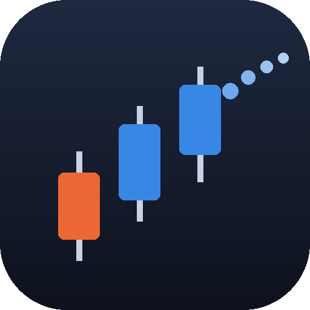
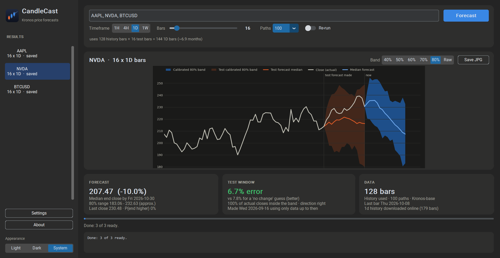
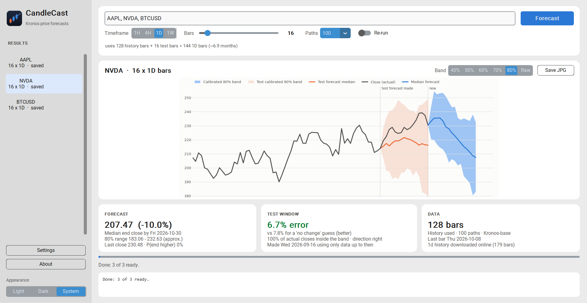

<p align="center">
  
</p>

<h1 align="center">CandleCast</h1>

<p align="center">
  A desktop tool for exploring probabilistic market forecasts with the open-source
  <a href="https://github.com/shiyu-coder/Kronos">Kronos</a> time-series foundation model.
</p>

<p align="center">
  
</p>

> CandleCast is shared for learning and information only - it is not a trading signal or investment
> advice. If you want to push the forecasts further, I'd encourage training or fine-tuning Kronos on your
> own data; the [Kronos repository](https://github.com/shiyu-coder/Kronos) includes fine-tuning scripts.

## Why I built it

CandleCast started from a question I had when experimenting with Kronos:

> **What does a model-generated price forecast actually tell me once I compare it with what happened afterwards?**

It is quite easy to generate a forecast and draw it into the future. What interested me more was whether that
forecast actually contained useful information, and how I could see that without simply looking at a
good-looking chart.

So I built CandleCast around two views.

The first is the normal forecast view: Kronos generates multiple possible future price paths, and CandleCast
shows the median forecast together with an uncertainty band.

The second is what I call the **test window**. CandleCast moves the same forecasting process back in time, only
gives the model information that would have been available at that point, and then compares its forecast with
what actually happened afterwards.

That became more important as I started testing Kronos more seriously.

Across the benchmark experiments in this repository, Kronos did not consistently beat a simple no-change
forecast on price error. Its original uncertainty bands were also much narrower than their stated coverage
suggested.

I also found one daily stock-ranking setup that initially looked quite interesting. Instead of treating that
result as an edge, I wrote down a confirmation test in advance and repeated it on a much larger group of stocks
that had not been used in the original experiment.

The result did not replicate.

I decided to keep those findings visible rather than design CandleCast around the best-looking examples.

For me, the project is therefore less about asking:

> **Where will the market go next?**

and more about asking:

> **What does the model expect, how uncertain is it, and how has the same forecasting process behaved when we
> could actually check the answer?**

## What it does

Enter a market symbol, choose a timeframe, and decide how many bars ahead you want the model to forecast.

CandleCast then uses Kronos to generate a number of possible future price paths and displays their median
together with an uncertainty range.

What makes the app slightly different is the **test window**.

Alongside the current forecast, CandleCast runs the same process from an earlier point in the data, without
allowing the model to see what happened next. The historical forecast is then plotted against the prices that
actually followed.

This gives you two things to look at:

- **Forecast** - what Kronos currently expects over the next N bars.
- **Test window** - how the same setup behaved over a historical period where the outcome is already known.

The app currently supports US stocks and ETFs, major FX pairs, crypto, gold, silver and oil, on 1-hour, 4-hour,
daily and weekly bars. You can also adjust the forecast horizon, the history length, the number of sampled
paths, the uncertainty-band level and the model (Kronos-base or Kronos-small), and save any chart as a JPG.

CandleCast runs locally on Windows. Forecast generation is done on your CPU, while market data is downloaded
from Alpaca or Yahoo Finance and cached locally.

<p align="center">
  
</p>

## What I found while testing it

Once the app was working, I wanted to know whether the forecasts were actually useful rather than only visually
convincing.

I therefore kept a separate set of benchmark experiments under [`benchmarks/`](benchmarks/). The current research
record contains roughly 6,800 out-of-sample forecasts across different bar sizes, history lengths and sampling
settings.

A few findings changed how I looked at the model and, eventually, how I designed CandleCast.

### Price forecasting was harder than the charts suggested

Across the configurations I tested, Kronos did not beat a simple no-change assumption on price error.

That was important because a forecast chart can still look reasonable even when it is not adding much
information over a very simple baseline. This is one reason I kept the historical test window inside the app:
I wanted the forecast to be shown together with something that makes it easier to judge.

### One promising ranking result did not survive a second test

I also tested whether Kronos might be more useful for ranking stocks by expected return rather than predicting
their exact future prices.

One daily configuration initially produced a mean RankIC of around +0.129, with a t-statistic close to 2. That
looked interesting, but it was also the strongest result among a number of configurations I had tested, so I did
not want to treat it as evidence immediately.

I wrote down a confirmation test before running it, fixed the model settings and pass criteria, and tested the
same idea on 103 instruments the original experiment had not used.

The result went in the opposite direction:

- Mean RankIC: **-0.083**
- t-statistic: **-1.84**

The original result did not replicate, so I currently treat it as noise rather than a trading edge.

[Read the pre-registered confirmation test ->](benchmarks/CONFIRMATION_q5_PLAN.md)

### The uncertainty bands needed calibration

Another issue appeared when I looked at forecast coverage. Kronos's raw 80% band contained only around 40% of
realised outcomes in my tests - the model's raw uncertainty range was considerably too narrow for the data I
tested.

CandleCast therefore includes calibrated bands based on historical forecast errors. The current calibration was
fitted using 640 historical 1-hour, 32-bar forecasts. For other timeframe and forecast-horizon combinations, the
app marks the calibrated band as approximate rather than assuming the same adjustment must work everywhere.

### Simpler volatility models were difficult to beat

I also compared Kronos's forecast dispersion with more traditional volatility models. In the current
experiments, GARCH(1,1) produced better volatility forecasts than Kronos across the setups I tested.

I do not see that as making the project unsuccessful. It changed the question I became interested in. Instead of
asking whether a foundation model automatically gives a better market forecast, I am now more interested in
understanding:

**What information does the model actually capture, where does it fail, and are those failures systematic enough
to learn something from?**

That is also why the benchmark results remain part of this repository rather than being separated from the
application.

### Research record

The [`benchmarks/`](benchmarks/) folder contains the experiments behind the observations above: out-of-sample price
forecasting tests, stock-ranking experiments, uncertainty-band calibration, comparisons with GARCH and EWMA,
sampling-stability and performance benchmarks, and the pre-registered confirmation experiment.

The purpose is not to prove that Kronos works as a trading model. It is to keep a transparent record of what I
tested, what appeared promising, and what failed when tested again.

## Install (Windows 10/11, 64-bit)

1. Download **`CandleCast-Setup-<version>.exe`** from the [latest release](../../releases/latest)
   (or the portable zip, if you prefer not to install anything).
2. Run it. It installs for your user only - no admin rights needed. Windows SmartScreen may warn that the
   app is from an unknown publisher (it is not code-signed); choose *More info -> Run anyway*.
3. Start **CandleCast** from the Start menu.

The first forecast downloads the chosen Kronos model once (Kronos-base about 410 MB; progress is shown in the
app). After that it loads from disk in a few seconds. A forecast takes roughly 30-90 seconds per ticker on a
typical laptop CPU with Kronos-base, faster with Kronos-small.

### Free Alpaca keys (for US stocks and ETFs)

US stock prices come from [Alpaca](https://alpaca.markets/). Create a free account, generate a key pair
(paper-trading keys are fine), and paste them into **Settings** in CandleCast. Crypto, metals, oil and FX
work without any keys. Keys are stored only on your computer, in `%LOCALAPPDATA%\CandleCast\.env`.

### Model choice

**Settings** lets you switch between **Kronos-base** (default, larger and slower) and **Kronos-small** (about
three times faster). Kronos-large has not been publicly released by its authors, so it is not offered. The
band calibration was fitted on Kronos-base forecasts.

## How the forecast works

| Setting | What it means |
|---|---|
| **Timeframe** | Bar size: 1H, 4H (built from 1H bars), 1D or 1W |
| **Bars** | N bars forecast ahead - and the size of the test window |
| **History** | Bars of past prices Kronos sees: 128 by default, adjustable 64-448 (capped at 512 - N). It does not change with N, so a longer forecast extends a shorter one |
| **Paths** | How many futures Kronos samples; more = smoother bands, slower |
| **Band** | Calibrated 40-80% range, or Kronos's raw band |

Why history is fixed: Kronos generates bar by bar, so with the same history the first 16 bars of a 27-bar
forecast are identical to a 16-bar forecast. Changing the *history* is what changes the path - Kronos tends to
pull forecasts toward the average of the window it sees, so a longer window can even flip the direction. Try the
History slider to see how sensitive a given forecast is. (Averaging several history lengths did not improve
accuracy in my backtests, so CandleCast does not do it.)

Data is cached per timeframe in `%LOCALAPPDATA%\CandleCast\data` and refreshed online each run; if the
download fails the local copy is used.

## Run from source / build the installer

Requires Python 3.11 on Windows.

```powershell
git clone https://github.com/chyr-rpg/candlecast.git
cd candlecast
py -3.11 -m venv .venv
.venv\Scripts\python -m pip install torch --index-url https://download.pytorch.org/whl/cpu
.venv\Scripts\python -m pip install -e ".[dev]"
.venv\Scripts\candlecast-app            # the desktop app
.venv\Scripts\python -m pytest -m "not slow"
```

Build the Windows app (PyInstaller) and installer ([Inno Setup 6](https://jrsoftware.org/isinfo.php)):

```powershell
.venv\Scripts\python -m pip install pyinstaller
powershell -ExecutionPolicy Bypass -File packaging\build.ps1
# -> dist\CandleCast\CandleCast.exe, dist\CandleCast-Setup-<version>.exe, dist\CandleCast-<version>-portable.zip
```

A command-line interface (`candlecast run / show / score`) and a nightly batch pipeline are also included
for research use - see `candlecast --help`.

## Credits and licence

- Model: [Kronos](https://github.com/shiyu-coder/Kronos) by Shi Yu et al. ([paper](https://arxiv.org/abs/2508.02739)),
  MIT licence; code vendored unmodified in `vendor/kronos`, weights downloaded from Hugging Face
  (`NeoQuasar/Kronos-base`, `NeoQuasar/Kronos-small`, MIT).
- CandleCast itself: MIT licence (see [LICENSE](LICENSE)); third-party components in
  [THIRD_PARTY_NOTICES.md](THIRD_PARTY_NOTICES.md).
- Market data: your own Alpaca account and Yahoo Finance (via yfinance) - their terms apply.
